# Electricity Demand Forecasting — Architecture Reference

**Tightened (no facts removed), Author: Angie Ohaeri (assisted), Date: October 29th Time: 2:20am CT**

Predicts short-term zonal electricity load on the **PJM Interconnection** from EIA-930 demand,
PJM LMP and weather data, on a streaming pipeline built around Kafka and TimescaleDB. Public
portfolio project for end-to-end ML engineering. Self-hosted on an Intel Mac Mini (Ubuntu 24.04).

---

## Data sources

| Source | Access | Used for |
|---|---|---|
| **gridstatus** (`pip install gridstatus`, [docs](https://opensource.gridstatus.io/en/latest/)) | `PJM()` class hits PJM endpoints directly; no paid `gridstatusio` client. Returns tz-aware DataFrames; dates accept "today", "latest", ISO-8601 or a `(start, end)` range in PJM local time | load, load forecasts, DA/RT LMPs, fuel mix |
| **EIA Open Data API v2** ([docs](https://www.eia.gov/opendata/documentation.php)) | free API key; `/v2/electricity/rto/` = EIA-930 hourly demand, forecast demand, net generation, interchange, with BA and subregion facets | load and generation-mix features |
| **PJM Data Miner 2** (`dataminer2.pjm.com`) | free pjm.com account for programmatic access; hourly RT LMP feed `rt_hrl_lmps` | LMPs |
| **Open-Meteo** | free, no key; current + hourly forecast (temp, precipitation, wind, cloud cover) and history | weather: all 20 in-scope zones via 30 stations (seven multi-climate zones average 2-3 stations); scaled up from 3-4 zones on Aug 12 (`decisions.md`) |

Load and LMP are both hourly. Each source lands in its own hypertable at native resolution and is
joined in a named dbt model, never resampled silently.

---

## Stack



- **Ingestion**: Kafka (KRaft, no ZooKeeper), topics `load`, `lmp`, `weather`. `confluent-kafka`
  producers poll the APIs (via `gridstatus` where possible); consumers write to TimescaleDB.
- **Storage**: TimescaleDB — one hypertable each for `load`, `lmp`, `weather` at native resolution,
  continuous aggregates for views that stay fresh as data arrives.
- **Features / orchestration**: dbt against TimescaleDB (lags, rolling means, the weather+load join,
  the hourly LMP alignment model), scheduled by Prefect.
- **Modeling**: LightGBM (primary), MLflow tracking and registry. Temporal Fusion Transformer is an
  optional extension (built for multivariate series with known future inputs like weather forecasts).
- **Serving**: FastAPI `/predict`, loads the production model from the MLflow registry and refreshes
  predictions on a schedule.
- **Dashboard**: Shiny for Python + Pydeck (deck.gl; better than Folium here): live zone load on a map,
  predicted load N hours ahead, weather overlay; calls FastAPI.
- **Deployment**: Docker Compose, everything in one `docker-compose.yml` on the Mac Mini; Cloudflare
  Tunnel container for public HTTPS with no port forwarding. Ubuntu 24.04 LTS is supported through 2029.

---

## ML details

- **Target**: zonal `load_mw`, N hours ahead. Hourly, matching EIA-930. LMP forecasting is the
  extension in `lmp-pricing-model/`.
- **Features**: hour, day of week, is_weekend, is_holiday, sin/cos time encoding; lags t-1h/3h/24h/168h;
  rolling means 6h/24h/7d; zone as a categorical feature plus zone load-profile stats (typical peak
  hour, weekday/weekend spread); current + forecast weather per zone (composite zones averaged across
  stations before publishing). Using the forecast, not just current conditions, is a differentiator.
- **Model**: one global LightGBM with zone as a feature (strong, fast, handles missing values);
  per-zone models and TFT worth trying later.

---

## Deployment notes

```bash
# Mac Mini: disable sleep (always-on server)
sudo systemctl mask sleep.target suspend.target hibernate.target hybrid-sleep.target

# Install Docker
curl -fsSL https://get.docker.com | sh
sudo usermod -aG docker $USER
```

Cloudflare Tunnel: free Cloudflare account, `cloudflared` as a compose service, automatic HTTPS, no
router port forwarding. A domain (~$10/yr) gives a clean public URL.

Build order (completed): producer → Kafka → consumer → TimescaleDB → backfill → LMP feed → dbt
features → LightGBM/MLflow → FastAPI → Shiny → Cloudflare Tunnel. Repo layout: CLAUDE.md; CCDS
conventions: `ccds-practices.md`.
