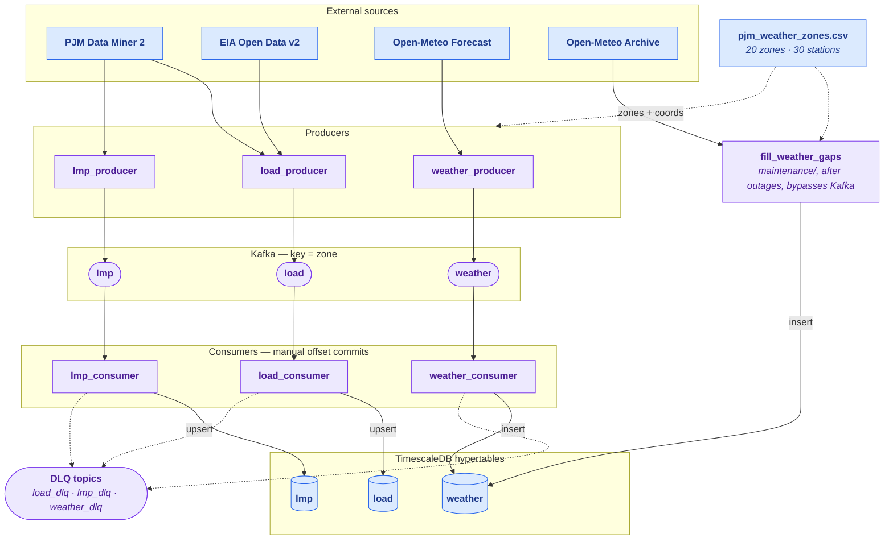
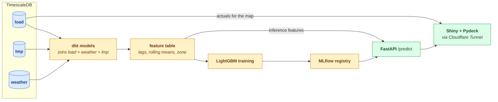
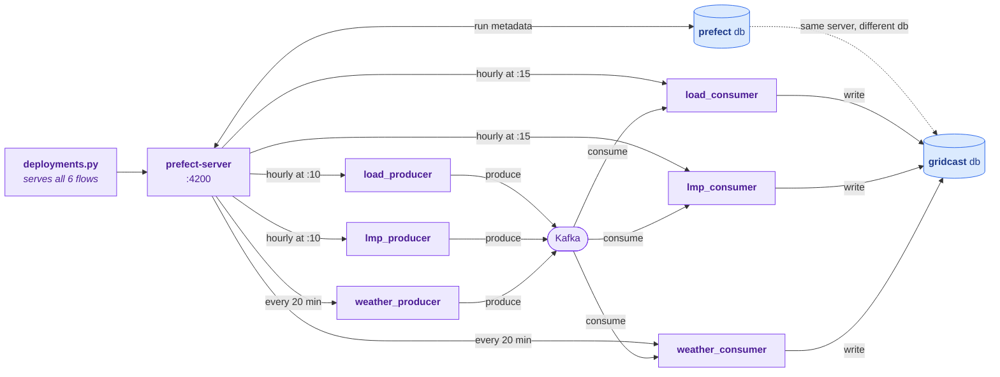

# Data Flow

**Title:** Data flow diagram — sources through storage, **Author:** Angie Ohaeri, **Date:** August 10, 2026 **Time:** 9:10pm (split into ingestion / downstream Aug 11 8:36am; tightened by Angie Ohaeri (assisted) Oct 29 2:25am CT)

Load stack only (the LMP model's batch syncs are in `lmp-pricing-model/`). Colors: <b>blue = data</b>, <b>purple = pipeline infra</b>, <b>amber = modeling</b>, <b>green = serving</b>. Endpoints and cadence: table at the bottom.

---

## Ingestion — sources to storage

Producers publish JSON keyed by zone with `acks=all` and idempotence on. Consumers commit offsets one message at a time; anything unparseable or DB-rejected goes to that source's DLQ topic and is committed past.

---

## Downstream — storage to serving

---

## Orchestration and control plane

Prefect runs every producer/consumer as a scheduled flow. It stores only run state, in a **separate `prefect` database on the same Postgres instance**.

---

## Per-source detail

| Source | Endpoint | Cadence | Topic → Table | Write semantics |
|---|---|---|---|---|
| PJM Data Miner 2 | `hrl_load_metered` | hourly, 7-day window | `load` → `load` | upsert on `(time, zone, source='pjm')` |
| EIA Open Data v2 | `electricity/rto/region-data` | hourly, 7-day window | `load` → `load` | upsert on `(time, zone='RTO', source='eia')` |
| PJM Data Miner 2 | `rt_hrl_lmps` | hourly, 7-day window | `lmp` → `lmp` | upsert on `(time, pnode_id)` |
| Open-Meteo Forecast | `/v1/forecast`, `current=` | every 20 min | `weather` → `weather` | append-only |
| Open-Meteo Archive | `/v1/archive`, `hourly=` | manual, after outages (`maintenance/fill_weather_gaps.py`) | *(none)* → `weather` | direct insert of missing zone-hours only |

**Trailing 7-day window:** PJM revises an hour unverified→verified over ~3 days, EIA over ~1 day; re-polling the week and upserting overwrites the same `(time, zone, source)` row. Weather has no revisions, so it is append-only.

**Frequency alignment:** load and LMP are hourly, stamped **hour ending**, so they join directly. Weather is polled every 20 minutes and resampled to hourly in dbt, not in the producer.
